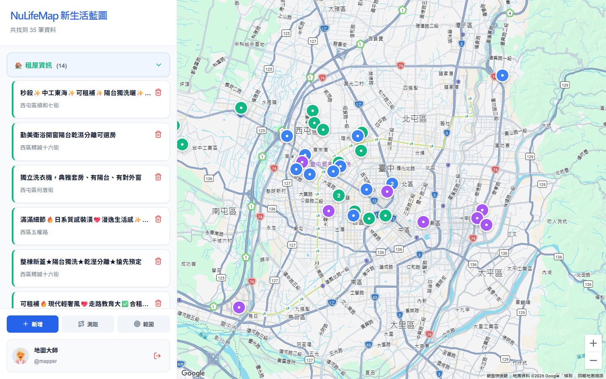
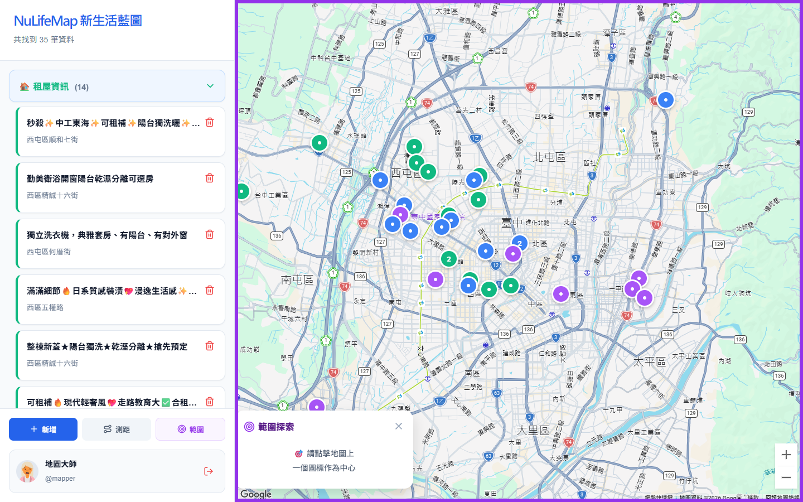
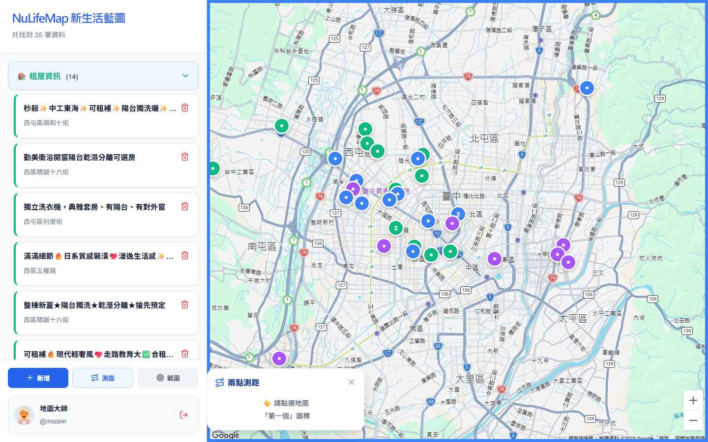

# NuLifeMap — 新生活藍圖

規劃新生活時用的地圖工作台：把租屋、職缺與自訂地點標在同一張乾淨地圖上，再用範圍與測距評估通勤與生活圈。

**Demo：** [https://nu-life-map-frontend.vercel.app](https://nu-life-map-frontend.vercel.app/)

---

## 解決了什麼痛點

當初離開南投要到台中時，新環境人生地不熟，因此想要先把工作職缺、租屋地點、周遭機能做個彙整，可惜現有的地圖工具並無法提供乾淨簡潔的頁面，讓地點分布一目了然，去進行後續的評估，因此這成為了我的第一個 side project。

---

## 技術棧（Tech Stack）

| 層級 | 技術 |
| --- | --- |
| 前端 | React 19、Vite、Tailwind CSS 4、`@react-google-maps/api`、Lucide |
| 後端 | Node.js、Express 5、Mongoose |
| 爬蟲微服務 | Python、FastAPI、Playwright（含 stealth）、BeautifulSoup、uvicorn |
| 資料庫 | MongoDB Atlas |
| 外部 API | Google Maps／Geocoding、Dicebear（頭像） |
| 部署 | 前端 Vercel；後端 Render；爬蟲可獨立服務部署 |

---

## 核心功能與技術亮點

### 登入與個人地圖資料

帳號登入後依使用者讀取專屬標記；前後端分離，前端連線 Render API。

### 地圖總覽：三色標記 × 側欄列表

居住（租屋）、工作（職缺）、生活（自訂）分色標示；左側列表可瀏覽／刪除，右側 Google Maps 同步顯示。

### 新增地點：貼上 Mai Job 網址

「網址抓取」可貼 [Mai Job](https://mai-job.hihimiles.com) 測試站職缺／租屋網址自動解析並標上地圖；也可改「自訂地點」手動輸入。

### 範圍探索

以地圖上某個標記為中心畫圈，直覺查看方圓範圍內的職缺／租屋分布。

### 兩點測距

選兩個地點計算路徑與時間，協助判斷通勤成本。

### 爬蟲與部署

- **網址解析**：原本做過自動解析，閱讀 robots.txt 與會員規約後，改成測試用假網站（[Mai Job](https://mai-job.hihimiles.com)）以符合平台規範。保留解析模組作為可插拔的功能，授權後可啟用。  
- **部署分工**：前端 Vercel、後端 Render、MongoDB Atlas、爬蟲可獨立擴充。
